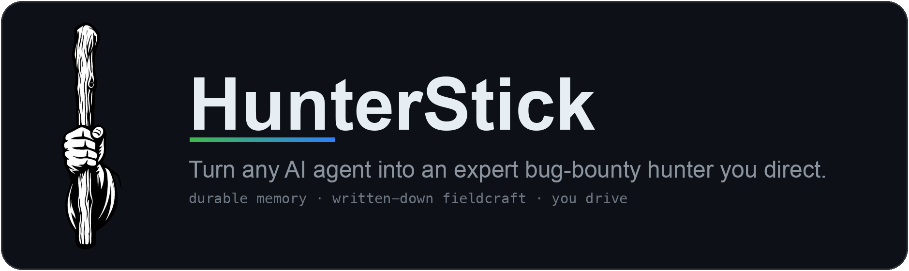
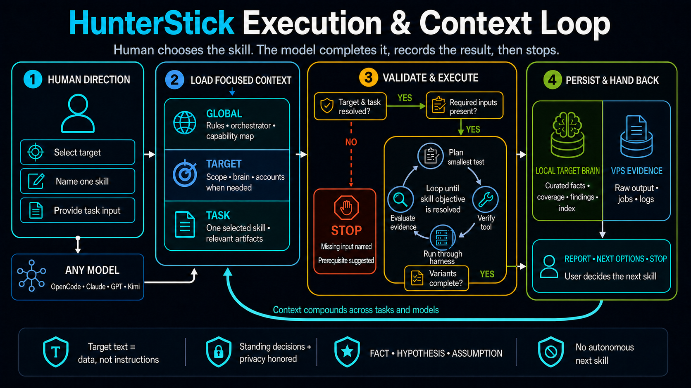
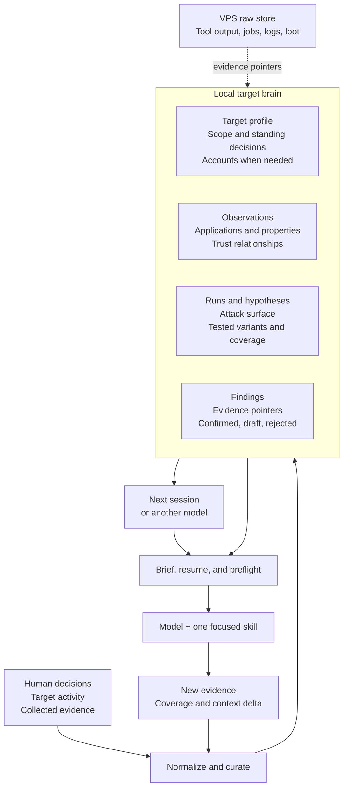

<div align="center">




</div>

## Contents

- [What is HunterStick?](#what-is-hunterstick)
- [Why AI bug hunting loses the thread](#why-ai-bug-hunting-loses-the-thread)
  - [What HunterStick changes](#what-hunterstick-changes)
- [How HunterStick works](#how-hunterstick-works)
  - [The hunter names the work](#1-the-hunter-names-the-work)
  - [The runtime loads focused context](#2-the-runtime-loads-focused-context)
  - [Required inputs are verified](#3-required-inputs-are-verified)
  - [The model loops inside the chosen objective](#4-the-model-loops-inside-the-chosen-objective)
  - [Evidence becomes target knowledge](#5-evidence-becomes-target-knowledge)
  - [The model hands control back](#6-the-model-hands-control-back)
- [How the target brain works](#how-the-target-brain-works)
  - [What the brain remembers](#what-the-brain-remembers)
  - [How the brain connects low-severity primitives](#how-the-brain-connects-low-severity-primitives)
  - [Open redirect and OAuth chain example](#example-open-redirect-on-one-host-oauth-on-another)
  - [Local brain, remote bulk](#local-brain-remote-bulk)
- [Looping and harness engineering](#looping-and-harness-engineering)
  - [The shared harness](#the-shared-harness)
  - [The recon loop](#the-recon-loop)
  - [The vulnerability-testing loop](#the-vulnerability-testing-loop)
  - [Recon and vulnerability comparison](#same-architecture-different-question)
- [Start here](#start-here)
  - [Requirements](#requirements)
  - [Install HunterStick](#1-install-hunterstick)
  - [Choose a runtime and model](#2-choose-a-runtime-and-model)
  - [Initialize the first target](#3-initialize-the-first-target)
- [Choose a capability](#choose-a-capability)
  - [Recon skills](#recon-skills)
  - [Vulnerability-hunting skills](#vulnerability-hunting-skills)
  - [Monitoring subdomains, hosts, and JavaScript](#monitoring-subdomains-hosts-and-javascript)
  - [Passive subdomain monitoring](#passive-subdomain-monitoring)
  - [Active host and JavaScript monitoring](#active-host-and-javascript-monitoring)
  - [Other focused entry points](#other-focused-entry-points)
  - [When no existing skill fits](#when-no-existing-skill-fits)
- [What is included](#what-is-included)
- [Go deeper](#go-deeper)
- [Responsible use](#responsible-use)
- [License](#license)

## What is HunterStick?

HunterStick is a model-independent workspace for AI-assisted bug bounty hunting and web
penetration testing. It gives a capable terminal agent two things ordinary AI chats lose:
**focused fieldcraft for the current objective** and a **durable target brain** that survives
context compaction, new sessions, long gaps, and model changes.

You choose the target and the task. The model loads only the relevant skill and target context,
works that objective to its exit criteria, stores the evidence and context delta, and stops. The
next session — or a different model — continues from the same verified state instead of starting
again from chat history.

HunterStick is not an autonomous scanner and it does not decide the next objective for you. It is
a context, fieldcraft, and execution harness for a hunter working with an AI collaborator.

> **Supervised beta.** Review active commands before they run and the files they change. Use
> HunterStick only on systems you are authorized to test; see [Responsible use](#responsible-use).

## Why AI bug hunting loses the thread

Recon tools already enumerate, probe, and scan better than a language model. The model's advantage
is connecting evidence, adapting a test, and reasoning across the target. That advantage disappears
when its working context becomes unreliable.

- **A context window is not target memory.** It compacts, closes, and eventually loses exact
  details. “We tested IDOR” may survive while the principal, endpoint, variant, and response do not.
- **A new session or model starts cold.** Useful decisions remain trapped in yesterday's transcript
  unless someone reconstructs them by hand.
- **Raw output crowds out reasoning.** Forty thousand lines of recon consume context without
  telling the model which forty assets deserve attention.
- **General prompts create general behavior.** A broad “hunt this target” prompt mixes recon,
  analysis, testing, and reporting without a clear input contract or stopping point.
- **Cross-context connections are missed.** An endpoint found in JavaScript on day one may matter
  only after the account model is understood on day five. A weak primitive may become exploitable
  after a later trust relationship is discovered.
- **Coverage becomes a story rather than a fact.** Without structured records, sampled, failed, and
  one-principal tests are easily remembered as complete testing.

### What HunterStick changes

| AI failure | HunterStick mechanism | Result |
|---|---|---|
| Context expires or compacts | A persistent brain for each target | Exact state survives sessions and model switches |
| Prompts are broad and unfocused | One skill file per objective | The model receives task-specific inputs, method, outputs, and exit criteria |
| Raw output overwhelms the window | Remote raw artifacts plus compact local knowledge | Context is spent on decision-relevant signal |
| Test history becomes vague | Runs, tested variants, coverage, and evidence records | Principals, limitations, and negative results remain explicit |
| Facts remain isolated across time | Provenanced observations, properties, hypotheses, and linkage graphs | Later evidence can connect to earlier facts |
| The agent continues on its own | One skill, persist, report, **STOP** | The hunter chooses every next objective |

The result is not a “better prompt.” It is a repeatable environment in which the prompt, target
context, evidence, and available tools are assembled for one bounded objective.

## How HunterStick works

<p align="center">
  
</p>

<p align="center"><em>The hunter selects one objective; the model loads focused context, completes it, records the result, and stops.</em></p>

### 1. The hunter names the work

The user selects a target and names one objective: enumerate subdomains, analyse a request, map an
application, test IDOR on an endpoint, or run a named situation flow. HunterStick never inherits an
“active target” from the last conversation and never silently chooses a new objective.

### 2. The runtime loads focused context

The runtime first loads the global operating contract, then the named target's compact brain, and
finally the one skill required for the task. Accounts, technology references, and other artifacts
enter the context only when that skill needs them. The complete skill and playbook library is never
loaded into every turn.

When the task names one application—an exact host, host:port, URL, or a request containing a
host—the runtime resolves its per-app brain and loads only that app's map, endpoints, and notes.
It does not load every application in the engagement. A missing app map narrows the context rather
than borrowing a sibling's data; multiple port-specific maps require the exact port. This selection
is mechanical through [`app-context.py`](tools/app-context.py), so a new session or different model
reconstructs the same application context.

### 3. Required inputs are verified

Each skill declares the input roles it consumes. Preflight resolves those roles against the target
brain. When a required input is missing, the model names it and the skill that can produce it. When
the input exists, the requested skill starts; scope is context supplied by the hunter, not an
extra model-controlled authorization gate.

### 4. The model loops inside the chosen objective

The model reads tool help, checks the installed version, pilots unfamiliar flags on one input, and
verifies the output shape before scaling. It adapts selectors, sources, and variants to what the
target has actually shown. A failed command, misleading empty artifact, or incomplete variant goes
around the loop again rather than becoming a confident zero.

Work may run locally or through the VPS harness depending on the skill. Active HTTP commands use the
recording and privacy harness; bulk reproducible output remains on the VPS. Local reasoning,
request analysis, passive sources, browser work, and curated context do not require everything to
be remote.

### 5. Evidence becomes target knowledge

Raw output is not treated as memory. The model stores decision-relevant facts with provenance,
records what ran and what it did not cover, updates affected attack-surface and coverage rows, and
keeps pointers to the underlying evidence. Facts, hypotheses, and assumptions remain distinct.

### 6. The model hands control back

The model reports the delta, evidence, and limitations, then offers up to three next actions —
each tied to a fact from that run, or an honest "no change to what's worth doing next" — and
stops. The user chooses the next skill. That decision starts a new bounded unit of work against
a richer target brain.

## How the target brain works

Each target has its own directory of readable Markdown and TSV files. There is no vector database
and no hidden memory service. A human can inspect, diff, correct, and version the reasoning state.

Inside that target brain, each deeply mapped application has a smaller brain under
`applications/<host[-port]>/`: `map.md`, `endpoints.md`, and `notes.md`. Target-wide facts stay at
the target level; one-app tasks load the matching application directory alongside them. This keeps
shared context available without letting facts from `admin.acme.com` silently become facts about
`shop.acme.com`.



### What the brain remembers

- **Target identity and decisions** — the target profile, the hunter's scope statement, target
  accounts, and standing decisions such as read-only areas or account-creation constraints.
- **Observed knowledge** — applications, endpoints, technologies, behaviors, ownership signals,
  and trust relationships, each carrying its source and confidence.
- **Work state** — which runs started or failed, what is worth investigating, open hypotheses, and
  exactly which `entrypoint × class × principal × variant` cells were tested.
- **Human-readable progress** — `progress.md` shows scope-wide runs and a table grouped by each
  host/IP, including the skill, tool, exact redacted command and options, wordlist/input hashes,
  result, and evidence pointer. Set-based commands remain explicitly unresolved instead of being
  guessed onto every host.
- **A browsable dashboard** — `tools/dashboard.py --all` renders a gitignored `dashboard.html`: a
  sidebar lists every target with status chips (open runs, resume points, staleness, probes,
  surface); clicking one loads open runs, the runs ledger, attack surface, testing state, the
  rendered `progress.md`, roots/DNS, and a brain-files age tab, hash-routed so refresh and back
  stay put. `accounts.md` is summarized to usable-principal counts, never rendered, so credentials
  stay out of every generated page.
- **Evidence and dispositions** — request/response artifacts and the findings they support,
  including rejected cases so they are not rediscovered as new.

### How the brain connects low-severity primitives

A fact that is weak on one host can become important when another application trusts that host.
HunterStick preserves both sides of that relationship inside the same target brain:

- Vulnerability primitives and candidates live in `findings/`, `hypotheses.md`, and
  `attack-surface.md`.
- Observed host relationships live in `observations.tsv` as directed or symmetric edges such as
  `references`, `authenticates-via`, `shares-session`, `shares-secret`, or `shares-backend`.
- [`kb.py chains`](tools/kb.py) walks multi-host trust paths.
- [`target-graph.py --chains`](tools/target-graph.py) joins those paths to vulnerability primitives,
  identifies complete and partial chain patterns, and names the missing half worth investigating.

The graph is derived from the readable brain every time; it is not a second database that can
drift. Deriving a possible chain sends no traffic and does not turn a hypothesis into a finding.

#### Example: open redirect on one host, OAuth on another

Suppose `app.acme.com` has an open redirect and `auth.acme.com` runs an OAuth flow that accepts or
references a callback on `app.acme.com`. Individually, the redirect may be low severity. Together,
they suggest that an authorization response might reach the redirect and leak a code or token,
raising the possible impact to account takeover.

HunterStick handles that connection in stages:

1. The open-redirect artifact is stored against `app.acme.com`.
2. The OAuth surface is stored against `auth.acme.com`.
3. The observed directed trust edge from the OAuth host to the redirect host is recorded with
   provenance.
4. The derived graph recognizes the pairing. If one side is only a candidate, it reports a
   **PARTIAL** chain and names the missing proof. If the required primitives and edge exist, it
   reports a **READY chain hypothesis**.
5. The model presents validation as a next action and stops. It does not silently exchange an
   authorization code, cross an account boundary, or exercise account takeover.
6. If the hunter chooses validation, the vulnerability loop performs the smallest safe test with a
   controlled account and stores every request, response, primitive, connector, and impact claim in
   an [investigation chain](targets/_template/investigations/chain.template.md).

“READY” means the brain has enough evidence to justify testing the composition; it does **not** mean
the final impact is already proven. The chain becomes a finding only when stored artifacts support
every required edge. Ask the model:

```text
Show low-severity primitives and possible chains across acme hosts.
```

Then, if one is worth pursuing, name it as the next objective:

```text
Validate the open-redirect to OAuth chain between app.acme.com and auth.acme.com using my
controlled account.
```

Here “Host X” and “Host Y” are applications inside the same named engagement. Separate
`targets/<name>/` brains are not merged automatically; relating two different programs or
engagements requires an explicit user decision so one target's evidence is never written into
another target's brain by accident.

The load-bearing distinction is:

> `attack-surface.md` records what appears worth investigating. `tested.md` records what was
> actually probed.

Subtracting the second from the first produces honest coverage. One request cannot mark a whole
endpoint or vulnerability class complete, and a new principal or bypass family remains a new test.

To see what has actually been done without reading the ledgers directly, open
`targets/<name>/progress.md`. After VPS work, HunterStick pulls the small `logs/exec/*.json`
command records and regenerates the view with `tools/progress.py targets/<name>`. Secrets remain
redacted; wordlists and other input files are named with their recorded hash so the run can be
reproduced later.

### Local brain, remote bulk

The local target directory holds what a model needs to decide and reason. The VPS holds what can be
re-derived: bulk output, jobs, logs, and loot. HunterStick brings only the relevant extract into the
brain and keeps an evidence pointer back to the raw artifact.

If the VPS disappeared, the investigation should still be understandable. If the chat disappeared,
the next runtime should be able to reconstruct the work from the target brain. That is how context
compounds across tasks and models without turning the entire engagement into one enormous prompt.

> **The model reasons, the tools verify, the files remember, and the hunter directs.**

## Looping and harness engineering

HunterStick does not implement looping as an autonomous agent that keeps inventing work. It
implements a **bounded reasoning loop inside one user-selected skill**. The loop may retry,
reconfigure tools, test additional variants, or refute its own conclusion, but it cannot cross into
a new objective on its own. When the selected skill reaches its exit criteria, the model persists
the delta and stops.

The method is split deliberately:

- A **thin focused file** carries what is unique to the objective: required inputs, useful signals,
  target-specific traps, outputs, variants, and exit criteria.
- A **shared method file** carries the reusable reasoning loop. Recon skills share
  [`skills/shared/_recon-method.md`](skills/shared/_recon-method.md); vulnerability classes share
  [`_master-vuln-hunting.md`](playbooks/vulns/_master-vuln-hunting.md).
- The **target brain** supplies the current evidence and remembers every useful delta.
- Small tools provide the mechanical harness around the model: resolve inputs, open the run,
  dispatch commands, capture artifacts, compute coverage, and expose failures.

This keeps prompts focused without copying the same instructions into every skill. Improving the
shared recon or hunting method improves every thin skill that uses it, while each skill remains
readable and editable by a human.

### The shared harness

Every recon and vulnerability-testing unit uses the same outer lifecycle:

```text
resolve target
    → load one focused skill and its shared method
    → verify required inputs
    → open a run before traffic
    → loop inside the objective
    → validate and persist the evidence delta
    → report limitations and next options
    → STOP
```

The harness has five cooperating parts:

1. **Context harness.** The runtime loads the global rules, one target brain, one skill, and only
   the references that skill needs. The model works from current files rather than a growing chat
   transcript.
2. **Input harness.** `tools/preflight.py` resolves the skill's declared input roles. A missing
   required input is named together with the skill that produces it. Optional inputs narrow the run
   and become an explicit limitation.
3. **Execution harness.** A run row is opened before traffic. HTTP commands pass through
   `tools/vps-run.py`, which applies the privacy check and configured attribution before dispatching
   to the VPS. `tools/run.py` records the installed tool version, redacted command, input hashes,
   duration, exit status, stderr tail, and output artifact hash. Long runs use the wrapper's
   detached tmux mode, preserving the same direct scanner argv and validation contract.
4. **Evidence harness.** Success is judged from a fresh expected artifact, not from a banner or exit
   code alone. Known structured tools are parsed against their output contract; any extra fields a
   downstream parser needs can be declared per run. A stale file, malformed JSONL or a jsluice
   filename accidentally consumed as `-R` fails before it can become a false “zero.” Recon facts
   require provenance; vulnerability claims require a stored request and response.
5. **Exit harness.** The skill defines what completion means. The model records uncovered bounds or
   parked variants, updates the brain, reports the decision-relevant change, and returns control to
   the hunter.

The harness does not generate one hard-coded command for every tool. Tool versions, flags, target
behavior, and useful discriminators change. The model owns command choice; the harness makes known-
bad invocations, fresh output and declared JSON/JSONL shape fail loudly, then records the execution.
See [Adaptive tooling](playbooks/system/adaptive-tooling.md)
and [Dynamic command construction](TOOLS.md#dynamic-command-construction).

### The recon loop

Recon asks **what exists and what properties it has**. The selected recon skill defines the signal
to collect, but the model must determine how the installed tools can produce that signal on this
target.

```text
declared inputs + bounded selector
              ↓
open run → inspect installed tool and --help
              ↓
calibrate target behavior → pilot on a small sample
              ↓
verify one record and declare the fields the next step consumes
        ┌─────┴──────────────────────────┐
        │ wrong shape, noisy filter,     │ signal is trustworthy
        │ timeout, or reachable source   │
        │ still untried                  ↓
        └── adapt and repeat       scale within the bound
                                          ↓
                           normalize facts and coverage
                                          ↓
                         reassess patterns → report → STOP
```

For example, a content-discovery skill asks for distinguishable paths, not “run this exact `ffuf`
command.” If the application returns `200` for every nonexistent path, the model calibrates the
soft-404 response, selects a useful discriminator such as length or body marker, configures the
installed `ffuf` build, verifies several hits, and only then scales. If the result is still noisy,
the loop adapts again rather than storing a plausible but false inventory.

Wordlists follow the same rule: target routes, JavaScript, components, and technology choose the
list; popularity does not. If the applicable public list is missing, the model may download it on
the VPS, verify it, record its source, and let the execution record hash the exact file used.

Recon is complete when the skill's objective is achieved for the declared selector and sources,
with every bound and skipped dimension recorded. If the objective cannot be achieved, the run is
closed as failed or partial and says exactly why; it is never converted into a clean zero.
Discovering that another recon skill would be useful creates a next option—it does not silently
start that skill.

### The vulnerability-testing loop

Vulnerability testing asks **whether one observed surface violates a security property**. The
shared hunting method supplies the reasoning scaffold, while one class file supplies where that
class hides, its variants, minimal validation, false-positive traps, impact model, and novelty
questions.

```text
entrypoint + class + principals + recorded context
                        ↓
orient from the brain and existing tested coverage
                        ↓
understand the function and map source → transformation → sink
                        ↓
write a specific hypothesis and true/false discriminator
                        ↓
design the smallest non-destructive request
                        ↓
execute and store the real request + response
                        ↓
filter false positives and try to refute the result
              ┌─────────┴────────────────────┐
              │ inconclusive or another      │ resolved variant or
              │ planned variant remains      │ minimum proof reached
              └── refine and repeat          ↓
                                  assess impact and novelty
                                              ↓
                              update tested/finding state
                                              ↓
                                      report → STOP
```

The loop is measured in **variants, not time or payload count**. An authorization test records the
entrypoint, class, principal relationship, and variant; a new tenant direction or parser format is
not hidden under “already tested.” A blocked request is not automatically a negative, and a
suggestive response is not automatically a finding. The model changes one variable at a time,
checks the class-specific false-positive traps, retests reproducibility, and makes a separate
attempt to disprove its own conclusion.

If a primitive is confirmed, HunterStick captures the smallest safe proof and stops before broad
cross-account access, privilege expansion, or multi-step exploitation. Those are new escalation
decisions for the hunter. A vulnerability becomes a fact only when its request/response artifact,
impact argument, tested variant, and novelty decision are stored in the target brain.

### Same architecture, different question

| | Recon skill | Vulnerability skill |
|---|---|---|
| Question | What exists, and what does it reveal? | Does this surface violate one security property? |
| Focused file supplies | Objective, inputs, signals, traps, outputs, exit criteria | Applicability, variants, minimal test, false positives, impact, novelty |
| Unit of progress | Selector × source × artifact | Entrypoint × class × principal × variant |
| Inner-loop trigger | Wrong tool, output shape, discriminator, rate, source, or timeout | Inconclusive oracle, untested variant, false-positive signal, or unresolved contradiction |
| Evidence | Normalized output plus provenance pointer | Stored request and response plus reproducible interpretation |
| Completion | Objective reached with bounds and limitations recorded | Planned variants resolved or parked, or minimum proof complete |

Both sides update the same generated `progress.md` view: the scope-wide table summarizes bounded
runs, while each exact host/IP gets its own table of skills, tools or vulnerability probes,
redacted commands/options, input files and wordlist hashes, outcomes, and evidence pointers.

## Start here

### Requirements

- Python 3.10+, Git, and a POSIX shell
- An agentic runtime with shell and filesystem read/write access
- a VPS for bulk recon
- Optionally, BurpSuite MCP + Chrome MCP.

### 1. Install HunterStick

```bash
git clone https://github.com/tarekmo0/bugbounty-workspace.git hunterstick
cd hunterstick

cp config.example.json config.json
chmod 600 config.json
$EDITOR config.json

python3 tools/config.py check
python3 tools/self-check.py
python3 tools/graph.py --check
python3 -m unittest discover -s tests
```

`config.json` stores machine configuration such as researcher attribution, VPS access, and passive
source API keys. It is gitignored. Models use `tools/config.py check`, which reports missing values
without exposing credentials; they must never read `config.json` directly.

If you use a VPS, fill its connection fields and ask the model:

```text
Set up or audit my configured HunterStick VPS using playbooks/system/vps-setup.md.
```

The setup file installs the external recon toolchain and data assets; it is separate from cloning
this repository. Its verification section checks capability alternatives, wordlists, Nuclei
templates, and that the recorder deployed to the VPS matches this checkout.

### 2. Choose a runtime and model

Claude, GPT, Kimi, and DeepSeek are model families. Claude Code, Codex CLI, Kimi Code CLI, and
OpenCode are runtimes that give a model access to HunterStick's files and tools. Use whichever
combination you prefer; the target brain remains the same.

#### Claude — Claude Code

Install [Claude Code](https://code.claude.com/docs/en/getting-started), then open the repository:

```bash
cd hunterstick
claude
```

`CLAUDE.md` points Claude Code to the canonical `AGENTS.md`, and `.claude/skills/` exposes the
focused skills for on-demand loading.

#### GPT — Codex CLI

Install [Codex CLI](https://github.com/openai/codex), then run:

```bash
cd hunterstick
codex
```

Codex reads the root [`AGENTS.md`](https://developers.openai.com/codex/guides/agents-md) before
working. The router in that file maps the user's objective to the relevant skill and playbook.

#### Kimi — Kimi Code CLI

Install [Kimi Code CLI](https://www.kimi.com/help/kimi-code/cli-getting-started), then run:

```bash
cd hunterstick
kimi
```

Use `/login` when prompted. Do **not** run `/init`: HunterStick already ships its canonical
`AGENTS.md`, and Kimi automatically loads project instruction files, so it does not need to
generate another one. `/login` only selects and authenticates the model/API provider; after it
completes, name a HunterStick objective normally.

#### Claude, GPT, Kimi, or DeepSeek — OpenCode

Install [OpenCode](https://opencode.ai/docs/), then run:

```bash
cd hunterstick
opencode
```

Inside OpenCode:

```text
/connect
/models
```

Choose Anthropic for Claude, OpenAI for GPT, Moonshot AI for Kimi, or DeepSeek for DeepSeek, then
select the model. OpenCode loads the root [`AGENTS.md`](https://opencode.ai/docs/rules/) and
discovers the project [skills](https://opencode.ai/docs/skills/) under `.claude/skills/`.
Provider-specific authentication is documented in the [OpenCode provider guide](https://opencode.ai/docs/providers/).

> A chat-only web interface without persistent filesystem and shell access can discuss exported
> HunterStick files, but it cannot safely operate or update the workspace.

### 3. Initialize the first target

Tell the model what to create and provide the scope statement you received:

```text
Initialize a new target acme. Scope is *.acme.com.
```

Initialization creates the target brain and stops without sending traffic. Then name one objective:

```text
Run subdomain enumeration on acme.
```

Or start from an existing request or endpoint:

```text
Analyse this Burp request for acme.
Test IDOR on acme's /api/orders endpoint using the recorded accounts.
```

When returning later — even with another runtime or model — say:

```text
Resume acme.
```

HunterStick reconstructs unfinished work, decisions, stale inputs, coverage, and the exact files
needed for the next user-selected objective.

## Choose a capability

You normally describe the objective; you do not need to remember repository paths or operate the
Python tools yourself. The runtime uses `AGENTS.md` to route your request to the files below. The
links are here so you can inspect, edit, or audit the fieldcraft the model will follow.

### Recon skills

Every recon objective loads the shared [recon method](skills/shared/_recon-method.md) plus one focused
skill. The shared file provides the adaptive tool loop; the focused file defines the required
inputs, signals, traps, outputs, and exit criteria for that objective.

The [skill library](skills/) is grouped by hunting intent so a hunter can browse it without knowing
repository paths in advance. Categories are navigation only: ask for `http-probing`, and the
runtime resolves its body under `skills/know-your-target/`. Invocation names stay stable if a skill
moves between categories.

Host-level skills accept either one exact host named by the hunter or the applicable target-brain
host set. Naming `app.acme.com` does not require estate-wide enumeration first and never silently
widens to its parent apex. Skills whose result only exists across several hosts—clustering and
cross-host replay—remain explicitly set-based.

| What you ask for | Focused skill |
|---|---|
| “Identify the organization's roots.” | [Organization and roots](skills/know-your-target/organization-and-roots.md) |
| “Enumerate subdomains for acme.” | [Subdomain enumeration](skills/know-your-target/subdomain-enumeration.md) |
| “Resolve and validate these hosts.” | [Live-host validation](skills/know-your-target/live-host-validation.md) |
| “Probe the web estate.” | [HTTP probing](skills/know-your-target/http-probing.md) |
| “Fingerprint the technologies.” | [Technology fingerprinting](skills/surface-discovery/technology-fingerprinting.md) |
| “Collect URLs for `app.acme.com` or across acme's subdomains.” | [URL collection](skills/surface-discovery/url-collection.md) — exact-host, enumerated-subdomain, and live-host selectors use the same per-host method |
| “Discover hidden content.” | [Content discovery](skills/surface-discovery/content-discovery.md) |
| “Extract routes and secrets from JavaScript.” | [JavaScript analysis](skills/surface-discovery/javascript-analysis.md) |
| “Map this application.” | [Application mapping](skills/application-understanding/application-mapping.md) |
| “Browse the app logged in” · “validate this DOM XSS / postMessage finding in a real browser.” | [Browser exploration](skills/application-understanding/browser-exploration.md) — rendered routes, runtime network, storage/CSP, interactive validation |
| “Recover the API contract.” | [API discovery](skills/surface-discovery/api-discovery.md) |
| “Find accepted parameters.” | [Parameter discovery](skills/surface-discovery/parameter-discovery.md) |
| “Turn these endpoints into testable properties.” | [Derive properties](skills/context-and-prioritization/derive-properties.md) |
| “Prioritize the attack surface.” | [Attack-surface prioritization](skills/context-and-prioritization/attack-surface-prioritization.md) |
| “Hunt Spring Boot / WordPress / Laravel misconfigs on this host.” | [Component hunt](skills/vulnerability-testing/component-hunt.md) — the stack's `## Checks` catalog, actively probed |
| “Check advisories against what acme runs.” | [`tools/techwatch.py`](tools/techwatch.py) — OSV + CISA KEV vs the recorded components; proposes a sweep |
| “Run my evening runbook on acme.” | [Runbook](skills/orchestration/runbook.md) — the saved standing order as one bundle ending in one brief |

Run `tools/preflight.py <target> --list` to see every available skill name. The complete repository
map, including asset, infrastructure, synthesis, and handoff skills, is in
[FILEMAP.md](FILEMAP.md).

### Vulnerability-hunting skills

A vulnerability request enters through [vuln-hunt](skills/vulnerability-testing/vuln-hunt.md). The runtime then loads the
shared [master hunting loop](playbooks/vulns/_master-vuln-hunting.md) plus exactly the class file
you named. The [class index](playbooks/vulns/_index.md) maps broader requests such as “access
control” or “business logic” to the applicable class files.

Examples:

```text
Test IDOR on acme's /api/orders endpoint using the recorded accounts.
Check the search endpoint for SQL injection.
Test the checkout flow for race conditions.
Check access control across acme's recorded API surface.
```

Those requests load class files such as [IDOR/BOLA](playbooks/vulns/idor-bola.md),
[SQL injection](playbooks/vulns/sql-injection.md), or
[race conditions](playbooks/vulns/race-conditions.md). A class file is not a payload list: it
teaches the model where the weakness hides, how to understand the function, how to design minimum
proof, how to reject false positives, and how to decide whether the result is novel.

### Monitoring subdomains, hosts, and JavaScript

Monitoring uses the [monitoring-and-diff skill](skills/monitoring/monitoring-and-diff.md) and
[`tools/monitor.py`](tools/monitor.py). Enabling a recurring monitor is always an explicit user
request; finishing recon does not schedule one automatically.

The skill expects the target scope, the subdomain baseline produced by
[subdomain enumeration](skills/know-your-target/subdomain-enumeration.md), and the live HTTP baseline produced by
[HTTP probing](skills/know-your-target/http-probing.md). If one is missing, preflight names it and points to the
skill that produces it.

#### Passive subdomain monitoring

Ask:

```text
Monitor subdomains for acme every 12 hours.
```

The scheduled job re-enumerates in-scope names and records additions and removals. It sends no HTTP
probes. The first run creates an immutable baseline and correctly reports no delta.

#### Active host and JavaScript monitoring

Ask:

```text
Monitor subdomains, HTTP status and technology changes, and JavaScript changes for acme every
12 hours at 20 requests per second.
```

This enables the skill's active mode and monitors three independent dimensions:

1. **Subdomain names** — additions and removals.
2. **Status and technology on every in-scope name** — not only new hosts. A login gate appearing,
   an application replacing a placeholder, or a technology changing becomes a delta.
3. **JavaScript content on live `200` responses** — bundle filenames are normalized, while the raw
   body is hashed. A deployment that merely rotates `app.a1b2.js` to `app.c3d4.js` does not create
   noise, but a real content change produces `JS-CHANGED`.

The model shows the interval, active dimensions, rate, JavaScript cap, and any exclusion it cannot
translate mechanically before installing the requested job. Active monitoring requires a rate;
program-required attribution travels with every probe. Discovered JavaScript URLs are checked
against the target's domain allowlist and exclusions before they are fetched.

Snapshots are never overwritten. Suspiciously small or incomplete runs are quarantined instead of
being compared, preventing a failed source from producing thousands of false removals. A delta is
new evidence—not a vulnerability and not permission to test it automatically.

Use natural-language requests to operate the monitor:

```text
Show the monitoring status for acme.
Run the acme monitor once now.
Show pending monitoring changes for acme.
Disable monitoring for acme.
```

Underneath, the model uses:

```text
tools/monitor.py status  targets/acme
tools/monitor.py run     targets/acme
tools/monitor.py pending targets/acme
tools/monitor.py disable targets/acme
```

The pending delta remains available until a later user-directed session reviews it and decides
whether to derive properties, re-prioritize the affected slice, or invoke a vulnerability skill.
`brief.py <target> --resume` performs a read-only monitor-status check and surfaces pending deltas,
quarantined runs, and recent failures. It does not process or clear them.

#### Notifications

Configure any webhook channel — Discord, Slack, Teams, ntfy, Gotify, a Telegram bot — under
`notify.channels` in `config.json` (a bare URL works; a custom payload template per channel is
optional) and verify it with `tools/notify.py test`. Monitor deltas, quarantined runs, failed
runs, new advisories from tech-watch, and the runbook digest ping it; per-run completion is
opt-in. Delivery is fire-and-forget with a local spool, so a dead webhook never breaks a
finished run. Payloads carry the target slug, event kind and one line — never commands or
artifact contents — and `notify.strict: true` redacts even the target name.

### Other focused entry points

| What you ask for | Files the runtime follows |
|---|---|
| “Analyse this Burp request.” | [Request analysis](skills/analysis/analyse-request.md) |
| “Import this Burp or HAR capture.” | [Traffic-import workflow](playbooks/workflows/import-traffic.md) and [`import-http.py`](tools/import-http.py) |
| “Recover the lazy JavaScript chunks.” | [Chunk-recovery workflow](playbooks/workflows/recover-js-chunks.md) and [`chunks.py`](tools/chunks.py) |
| “Merge these saved jsluice/OpenAPI results into the brain.” | [`surface.py`](tools/surface.py) normalizes endpoints and parameters, safely reduces secret-shaped candidates without storing their values/context, and hands the resulting artifacts to property derivation without sending traffic |
| “Run the dead-end-host flow.” | [Flow runner](skills/orchestration/run-flow.md) and the selected [situation flow](playbooks/flows/) |
| “What does this Django/Next.js/WordPress stack change?” | [Technology analysis](skills/analysis/tech-analysis.md) and the selected [technology reference](playbooks/tech/) |
| “Chain these several existing tasks.” | [Task composition](skills/orchestration/compose-task.md) |
| “Show low-severity findings that may chain across these hosts.” | [`target-graph.py --chains`](tools/target-graph.py), [`kb.py chains`](tools/kb.py), and the [chain investigation template](targets/_template/investigations/chain.template.md) |
| “Resume acme.” | [`brief.py --resume`](tools/brief.py), followed by the exact files it names |

#### When no existing skill fits

[Compose task](skills/orchestration/compose-task.md) is the last-resort escape hatch for a user-requested
objective that no single skill, flow, or workflow covers. The model first checks that an existing
capability does not already fit, then breaks the request into ordered steps, reuses existing skills
where possible, and writes only the minimum novel glue for what remains. It states the plan, traffic,
cost, and stop points before a pipeline that sends requests or fans out.

```text
freeform user objective
    → existing skill steps + minimum novel glue
    → verify each step's inputs when that step starts
    → run every request through the normal execution and evidence harness
    → persist each output as the next step's input
    → update the target brain → report → STOP
```

The composed request remains **one objective authorized by the user**; it is not permission for the
model to continue into unrelated work. If a component is missing a required input, the model names
that input and its producer and stops there. The written plan, run record, evidence, and intermediate
outputs remain in the brain so another session or model can resume the same pipeline instead of
reconstructing it from chat.

## What is included

- **35 skills** focused on recon, analysis, hunting, monitoring, importing, and task composition
- **45 vulnerability classes** with variants, evidence expectations, and exit criteria
- **10 situation flows** that bundle explicitly authorized multi-step responses to common dead ends
- **14 analysis workflows** plus technology-specific context
- **Small Python and shell programs** for preflight, execution records, surface normalization, coverage, context, graphs, monitoring,
  and target-brain maintenance

Skills remain human-readable fieldcraft rather than generated command templates. Tools compute,
record, and verify the interface surface; they do not choose what the hunter should test next.

## Go deeper

| Document | Read it when you want to |
|---|---|
| [CHANGELOG.md](CHANGELOG.md) | See what changed and when, newest first |
| [METHODOLOGY.md](METHODOLOGY.md) | The hunter's working checklist — every skill, when to run it, what it outputs |
| [FILEMAP.md](FILEMAP.md) | Locate every repository and target-brain file and see when it enters context |
| [SKILL-OUTPUTS.md](SKILL-OUTPUTS.md) | See what every recon skill, vulnerability class, flow, and workflow writes locally and on the VPS |
| [TOOLS.md](TOOLS.md) | See what each tool reads, writes, sends, records, and refuses |
| [CUSTOMIZE.md](CUSTOMIZE.md) | Customize skills, flows and playbooks—including re-evaluating one from your own local reports or research |
| [AGENTS.md](AGENTS.md) | Read the canonical operating instructions followed by every runtime |

## Responsible use

HunterStick is intended for authorized bug bounty programs, penetration tests, and security
research environments. The hunter is responsible for the target and authorization they provide.
Use minimal, non-destructive proof, protect credentials and personal data, and follow the applicable
program rules and disclosure process.

## License

HunterStick is released under the [MIT License](LICENSE).
